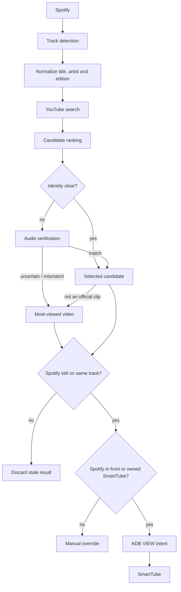

# Spotify With YouTube

**Choose the track in Spotify. Watch the video in SmartTube.**

This local Python bridge follows Spotify playback on Android TV / Google TV, identifies suitable YouTube videos and opens them in SmartTube. When a clip launched by the bridge finishes, Spotify can advance to the next song and the next video follows.

It goes beyond title search: the matcher checks artists, editions (radio edit, remix, live), official sources and, when needed, audio similarity. If no official video of the correct edition can be verified, it selects a popularity-based fallback **without calling it an exact match**.

The Mac hosts the service; ADB handles TV playback. A user-priority guard prevents automated sends when the TV is no longer in a session controlled by Spotify or the bridge.

[](https://github.com/searadacunha/Spotify-With-Youtube/actions/workflows/tests.yml)

[Quick start](#quick-start) · [Matching logic](#the-important-part--matching-the-right-version) · [Real-device validation](#what-is-verified) · [Limitations](#limitations)

**Verification status:** matching, delivery and five consecutive end-of-clip handoffs were observed on a real Android TV (2026-10-23). Several manual-override scenarios are unit-tested but still need end-to-end hardware checks.

---

## The result

On a real Android TV session, the bridge correctly handled examples such as:

| Spotify track | Selected on SmartTube | Result |
| --- | --- | --- |
| **Juice WRLD — Robbery** | official music video | audio verified across three windows: 0.978 / 0.979 / 0.982 |
| **The Underdog Project — Summer Jam - Radio Edit** | official Radio Edit audio | rejected the similarly titled VEVO upload because it was a different arrangement |
| **Marshmello & Juice WRLD — Bye Bye** | official lyric video | no official clip found; lyric video beat the visualizer after audio verification |

It also cancelled obsolete searches when Spotify changed tracks before the YouTube resolution finished.

And after the user-priority guard was added, the service became **fail-closed**:

> it sends a video only while you are in Spotify on the TV, or in the SmartTube clip it opened itself. Another app, a video you started yourself, or a TV state it cannot read: it sends nothing.

The matching path has been exercised on real hardware.

On 2026-10-23, five clips in a row ended on the TV, and each time Spotify moved to the next song and its video was sent automatically, without touching the remote.

The rest of the user-priority guard (other apps, pauses, a video you pick yourself) is unit-tested; its full hardware checklist is not finished.

---

# Why I Built It

Spotify already knows exactly what I am listening to.

YouTube usually has the official clip.

SmartTube already gives me the TV experience I want.

The missing piece was a direct connection between them.

A naïve implementation would do this:

```
artist + title
→ YouTube search
→ first result
→ open it
```

That works until it doesn't.

A track called:

**Summer Jam - Radio Edit**

is not automatically the same recording as:

**Summer Jam**

or:

**Summer Jam (Remix)**

or:

**Summer Jam (Live)**

or even a video carrying the same title but using another arrangement.

For a music automation, "close enough" is wrong.

So I built the bridge around one rule:

> **An official clip is sent only when it is proven to be the same edition. Otherwise the bridge sends the most-viewed YouTube video for the song: every song gets a video.**

The edition check decides what counts as the real clip; view count only picks the fallback.

---

# What Spotify With YouTube Does

The pipeline is:

```
Spotify
   ↓
current track detected
   ↓
title / artist / edition normalized
   ↓
YouTube candidates searched
   ↓
official sources ranked first
   ↓
wrong remix / live / edit / cover rejected
   ↓
audio compared when metadata is ambiguous
   ↓
Spotify checked again for stale results
   ↓
TV ownership checked
   ↓
ADB VIEW intent
   ↓
SmartTube
```

The project is primarily designed for:

- **Spotify on Android TV / Google TV**
- **SmartTube as the playback target**
- **a Mac running the bridge in the background**

Spotify Desktop on macOS and the Spotify Web API also exist as optional sources.

---

# The Important Part — Matching the Right Version

This repository is not just an ADB launcher.

Behind that simple experience, the project identifies **which video actually corresponds to the Spotify track**.

The matcher uses:

- Spotify track metadata
- artist identity
- base-title normalization
- edition detection
- duration consistency
- official artist / VEVO / label-source preference
- explicit remix / live / radio-edit / remaster handling
- detailed YouTube metadata
- audio comparison when metadata is not enough
- most-viewed fallback when no official clip is proven

The selection order is:

1. **official music video of the exact Spotify edition**, proven as above
2. otherwise, **the most-viewed search result** naming the song and the artist (then the song alone, then any result): official audio, lyric video, another edit's clip or a fan upload

View count never proves a clip; it only picks the fallback, so every song gets a video.

The goal is simple from the user's side: the song you choose on Spotify becomes the corresponding video on SmartTube.

---

# Real Example — Summer Jam

The Spotify track was:

> **The Underdog Project — Summer Jam - Radio Edit**

A VEVO result looked attractive.

Same artist.

Same recognizable title.

Official source.

But the audio told a different story.

The measured similarities against the Radio Edit reference were approximately:

```
0.48
0.38
0.36
```

with offset drift of roughly **33 seconds**.

That candidate was rejected.

The system selected the official publication carrying the actual **Radio Edit** instead.

This is exactly the kind of mistake a normal title-only automation would make.

---

# Real Example — Juice WRLD, Robbery

The official music video is shorter than the Spotify track.

A duration-only rule could reject it.

Instead, the bridge compared three parts of the recordings.

Measured similarity:

```
0.978
0.979
0.982
```

with a stable offset.

The video was accepted.

That is the difference between checking metadata and checking identity.

---

# Audio Verification

When metadata cannot settle the decision, the bridge can compare YouTube publications directly.

It does **not** capture the Spotify audio stream.

Instead it compares a candidate against a YouTube reference publication corroborated by the Spotify metadata.

Current method:

- three windows
- 20 seconds each
- sampled around 20%, 50% and 80% of the reference
- 48 log-spaced spectral bands
- normalized cross-correlation
- offset search up to ±45 seconds

A match requires strong similarity across all windows and stable timing.

Ambiguous results do not send.

Temporary audio files are deleted after decoding.

---

# User Priority Comes First

This project originally proved that the automation could send the correct video to SmartTube.

Then I found the more important problem:

**automation must never fight the person using the TV.**

So the delivery path now starts disarmed.

It arms itself only when:

- Spotify is the app in front on the TV: choosing a song there is the request to see its clip
- or the user explicitly runs `./smarttube resume` while a SmartTube video plays

If the user:

- leaves SmartTube
- pauses or stops playback
- replaces the current video manually
- moves to another TV app
- creates an unreadable playback state

the bridge enters a persistent manual override.

It does not wake the TV.

It does not force SmartTube back to the foreground.

It does not keep sending videos.

Returning to SmartTube alone does not re-enable automation.

Going back to Spotify on the TV does, or an explicit resume.

While a clip plays, SmartTube has the audio focus and Spotify is paused.

So when the clip the bridge sent ends, the bridge moves Spotify to its next track and brings Spotify back in front, which sends the next clip.

The songs follow each other in Spotify, not in SmartTube's autoplay.

A track Spotify is already playing is never skipped.

---

# Protection Against Old or Duplicate Sends

Music matching can take time.

Searches, metadata reads and audio comparisons may finish after Spotify has already changed tracks.

Before sending anything, the bridge reads Spotify again.

If the track changed:

```
STALE
```

The result is discarded.

The project also remembers the last track sent or attempted for a destination, so the same track is never sent twice in a row, even across:

- restarts
- matching-rule changes
- uncertain deliveries

A → B → A sends A again: playing a song later brings its clip back.

---

# Architecture



Main modules:

| File | Role |
| --- | --- |
| `main.py` | service loop, stale checks, deduplication |
| `tv_source.py` | Spotify metadata from Android TV |
| `spotify_source.py` | optional macOS / Spotify Web API sources |
| `youtube_match.py` | YouTube search, scoring and edition logic |
| `audio_match.py` | spectral audio verification |
| `smarttube_adb.py` | Android / SmartTube delivery |
| `storage.py` | SQLite cache and persistent state |
| `control.py` | CLI and macOS LaunchAgent |

Full architecture: [docs/ARCHITECTURE.md](docs/ARCHITECTURE.md)

---

# Quick Start

## 1. Requirements

You need:

- macOS
- Python 3.12+
- Android TV / Google TV
- ADB debugging enabled
- SmartTube installed
- Spotify available as a source
- FFmpeg
- Node.js

Install the host tools:

```sh
brew install android-platform-tools ffmpeg node
```

## 2. Clone

```sh
git clone https://github.com/searadacunha/Spotify-With-Youtube.git
cd Spotify-With-Youtube

python3 -m venv .venv
.venv/bin/python -m pip install -r requirements.txt
```

## 3. Configure the TV

```sh
cp config.example.json config.json
```

Set your TV target in `config.json`:

```json
{
  "tv_target": "192.168.x.x:5555"
}
```

Then connect:

```sh
adb connect 192.168.x.x:5555
```

Android 11+ may require wireless-debugging pairing first.

See [docs/ADB.md](docs/ADB.md).

## 4. Check everything

```sh
./smarttube check
```

This checks the local dependencies, configuration, ADB target, SmartTube package and current Spotify track.

## 5. Test without sending anything

```sh
./smarttube test
```

The entire matching path runs, but no video is launched.

## 6. Start the service

```sh
./smarttube start
```

It starts **disarmed**.

Pick a song in Spotify on the TV: Spotify in front arms the bridge.

Or open SmartTube yourself, play a video, then:

```sh
./smarttube resume
```

Now the bridge is allowed to control that SmartTube session.

Logs:

```sh
./smarttube logs
```

Full installation guide: [docs/INSTALLATION.md](docs/INSTALLATION.md)

---

# Match Any Track Without a TV

The matching engine can also be used directly:

```sh
./smarttube match \
  --artist "The Underdog Project" \
  --title "Summer Jam - Radio Edit" \
  --duration 214
```

This does not need Spotify playback or an Android TV.

It returns the candidate ranking and the selected result: `match` (proven official clip) or `most_viewed` (fallback).

---

# What Is Verified

The repository separates hardware observations from code that only exists in tests.

## VERIFIED on real hardware

- Spotify track detection from the TV over ADB
- version-aware YouTube matching
- official-source preference
- audio verification
- stale-result cancellation
- SmartTube delivery by Android VIEW intent
- Spotify in front arming the bridge
- clip end → Spotify's next track → its clip (five times in a row, 2026-10-23)
- positive / negative matching cache
- macOS background service
- dry-run mode

## IMPLEMENTED and unit-tested

- persistent user-priority / manual-override guard
- no same-track resend in a row, across restarts
- Spotify Desktop source on macOS
- Spotify Web API source
- direct `./smarttube match` command

The user-priority guard was added after the earlier real-TV matching runs.

On the TV, Spotify in front armed it and the end-of-clip handoff worked five times in a row;
disarming on other apps, pauses and manual videos is unit-tested only, and the full
checklist in `docs/TESTING.md` is not finished.

That distinction is deliberate.

---

# Tests

Run:

```sh
.venv/bin/python -m unittest discover -s tests -v
```

Current suite:

**107 unit tests**

covering:

- title and edition grammar
- remix / live / radio-edit handling
- scoring
- official-source rules
- duration checks
- album conflicts
- audio-verification verdicts
- most-viewed fallback
- cache
- deduplication
- stale-result cancellation
- dry-run isolation
- ADB targeting
- ADB failures
- user-priority guard
- end-of-clip handoff to Spotify's next track
- repository hygiene

GitHub Actions runs the suite on Python **3.12 and 3.13** and rebuilds the Android probe from source.

See [docs/TESTING.md](docs/TESTING.md).

---

# Logs Tell You Why

A normal decision is explainable.

Example:

```
SPOTIFY ... | Juice WRLD — Robbery
CANDIDATE 01 tier=1 ... OK | iI34LYmJ1Fs | Juice WRLD - Robbery (Official Music Video)
SELECTED iI34LYmJ1Fs
SENT video=iI34LYmJ1Fs

SPOTIFY ... | Juice WRLD — Fast
NO VERIFIED CLIP (No reliable reference for the Spotify edition): most viewed video instead
SELECTED lzQpS1rH3zI score=0 | Juice WRLD - Fast
SENT video=lzQpS1rH3zI
```

Other important outcomes:

```
NO VERIFIED CLIP
NO RELIABLE MATCH
STALE
DRY-RUN
CLIP_ENDED
MANUAL_OVERRIDE_ENTER
MANUAL_OVERRIDE_ACTIVE
SEND_BLOCKED_FOREGROUND_APP
SEND_BLOCKED_ALREADY_HANDLED
```

The goal is not just automation.

It is automation that can explain why it acted — or why it refused to act.

---

# Why SmartTube?

SmartTube is the recommended target because it works well as an Android TV playback destination and exposes enough playback state for the current control guard.

The official YouTube TV app can receive Android VIEW intents, but the current bundled media-session probe does not provide everything required to give it the same ownership guarantees.

So official YouTube support is not claimed as equivalent today.

See [docs/SMARTTUBE.md](docs/SMARTTUBE.md).

---

# Limitations

This is not magic.

Current limits include:

- the Mac must stay awake while it hosts the service
- YouTube search is bounded and cannot prove that no better upload exists anywhere
- audio verification compares YouTube publications, not Spotify's own stream
- the audio thresholds are empirical
- SmartTube takes the TV's audio focus: Spotify pauses during each clip and moves on when it ends; pausing the clip or starting another video stops that chain until you pick a song in Spotify
- the full manual-override checklist is not finished on real hardware
- ADB foreground-state verification and intent dispatch are separate operations, so they are not perfectly atomic

The project therefore fails closed whenever state cannot be trusted.

See [docs/LIMITATIONS.md](docs/LIMITATIONS.md).

---

# Security

The repository contains no music or video files.

It does not require:

- a YouTube API key
- YouTube cookies
- browser automation
- a Spotify account token when using the default TV source

Local logs can contain:

- track names
- track IDs
- TV network address

They are git-ignored.

See [docs/SECURITY.md](docs/SECURITY.md).

---

# Roadmap

Possible next steps:

- finish the hardware checklist of the user-priority guard
- Linux host support
- Raspberry Pi / always-on host
- Windows support
- multi-TV routing
- improved artist / channel verification
- optional web UI
- official YouTube target support with equivalent playback-state guarantees

---

# The Principle Behind the Project

The code is not built around:

> "Find something that looks like the song and play it."

It is built around:

> **Identify the recording. Respect the user. Send only when both are clear.**

That is the entire idea behind **Spotify With YouTube**.

---

# Documentation

- [Installation](docs/INSTALLATION.md)
- [Architecture](docs/ARCHITECTURE.md)
- [ADB](docs/ADB.md)
- [SmartTube](docs/SMARTTUBE.md)
- [Matching](docs/MATCHING.md)
- [Testing](docs/TESTING.md)
- [Troubleshooting](docs/TROUBLESHOOTING.md)
- [Limitations](docs/LIMITATIONS.md)
- [Security](docs/SECURITY.md)

---

# Contributing

See [CONTRIBUTING.md](CONTRIBUTING.md).

Changes to matching logic should come with tests.

Per-track or per-channel hard-coded exceptions should not be used to make examples pass.

---

# License

MIT — see [LICENSE](LICENSE).

This project is not affiliated with Spotify, Google, YouTube or SmartTube.

Spotify, YouTube, Android and other trademarks belong to their respective owners.

SmartTube is an independent project. This repository does not distribute SmartTube or any media.
