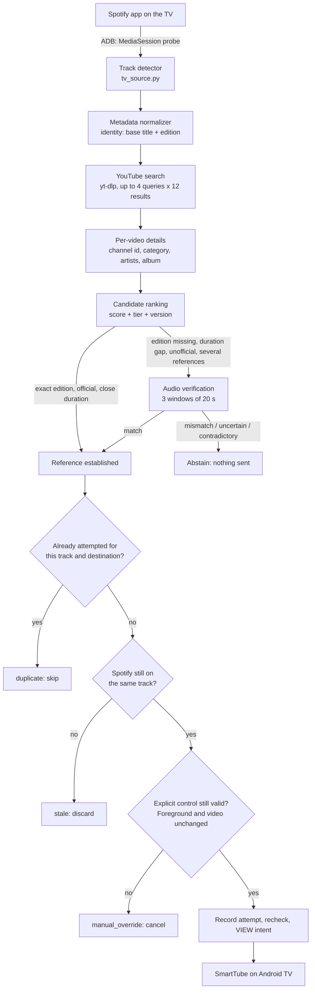
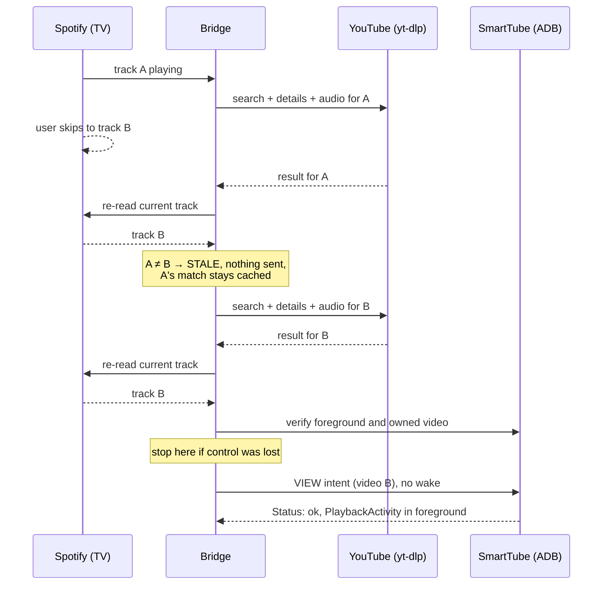

# spotify-smarttube-bridge

**Play a song on Spotify and automatically open the best matching music video on SmartTube running on your Android TV.**

Sync only runs while a SmartTube session you explicitly enabled is still in the
foreground; switching to any other app on the TV disarms it until you resume.

[](https://github.com/searadacunha/spotify-smarttube-bridge/actions/workflows/tests.yml)

[](LICENSE)

A small macOS background service watches what Spotify is playing, works out which
YouTube video is **the same recording and the same edition** as the Spotify track,
and sends that video only while an explicitly enabled SmartTube session still owns playback.
The user-priority guard is tested with mocked ADB; it has not been tested on a real TV.

```
Spotify (on the TV)  →  track detected  →  YouTube search + version-aware ranking
   →  audio verification when ambiguous  →  deduplication  →  ADB intent  →  SmartTube
```

## The core idea

This is **not** "search `artist + title` on YouTube and open the first hit".

The bridge tries to determine which video actually represents the Spotify
*version* currently playing. A video with the right artist and the right title
but the **wrong version** (remix, live, sped up, remaster, extended mix...) is
not accepted automatically. When nothing can be identified with enough
confidence, the bridge **abstains**: sending nothing is better than playing the
wrong version.

Identity is established from:

- Spotify metadata (id, title, artists, duration, album);
- version-aware candidate ranking (`Summer Jam - Radio Edit` ≠ `Summer Jam (Alle Farben Remix)`);
- official-source preference (artist channel, VEVO, label "Topic" releases, verified publishers);
- duration consistency;
- **real audio comparison** between YouTube publications when the metadata leaves doubt;
- abstention when confidence is insufficient.

Details: [docs/MATCHING.md](docs/MATCHING.md).

## Verified examples

Selections made automatically by the service on 21 October 2026 (rules version 7,
real Spotify TV playback, real YouTube search, real ADB delivery). Video ids are
public YouTube ids.

| Spotify track | Chosen video | Why |
| --- | --- | --- |
| Juice WRLD, *Robbery* | `iI34LYmJ1Fs`, official music video | Clip is 22 s shorter than the track, so its audio was compared with the official audio: three windows at 0.978 / 0.979 / 0.982 similarity, constant offset. |
| The Underdog Project, *Summer Jam - Radio Edit* | `c0AwLOvF9MA`, official audio (Radio Edit) | The VEVO video `oFasAHxqQoM` carries the same title but a different arrangement: similarities 0.48 / 0.38 / 0.36 with 33 s of offset drift, rejected. No official clip of the Radio Edit itself was found, so the official audio is played. |
| Marshmello & Juice WRLD, *Bye Bye* | `ZnQMqj-Sbec`, official lyric video | No official clip; the visualizer and the lyric video were compared (0.996) and the lyric video ranked first. |

Two other events in the same session: a search that finished after the user had
already skipped to another track was **cancelled** (`STALE`), and a restart of the
service did **not** resend the video already playing (`duplicate`).

These runs predate the user-priority guard added later the same day. The matching
rules are unchanged (version 7); the delivery path now additionally requires an
explicitly enabled SmartTube session, which has not been exercised on hardware yet.

## Features

Labels: **VERIFIED** (observed on real hardware, see above), **IMPLEMENTED**
(code and unit tests exist, not exercised end to end on this project's hardware),
**EXPERIMENTAL**, **PLANNED**.

- **VERIFIED** Reads the track playing in the **Spotify app of the TV itself** over ADB (no Spotify account token needed).
- **VERIFIED** Version-aware YouTube matching with official-source priority and abstention.
- **VERIFIED** Audio verification on three windows between YouTube publications when metadata is ambiguous.
- **VERIFIED** Delivery to SmartTube with an Android `VIEW` intent (observed before the user-priority guard below existed).
- **IMPLEMENTED** User-priority guard: before any intent the bridge checks that SmartTube is the focused app and still plays the video it last sent; leaving SmartTube, pausing or replacing the video enters a persistent manual override that only `./smarttube resume` clears. Unit-tested with mocked ADB, **not yet exercised on a real TV**.
- **IMPLEMENTED** Handled-track history: a track sent (or attempted) to a destination is never resent automatically, across restarts, A → B → A and rule changes. The pre-guard "no resend after restart" behaviour was verified on hardware; the new table is unit-tested.
- **VERIFIED** 90-day positive match cache, 24-hour negative cache.
- **VERIFIED** Stale-result cancellation when Spotify changes track during a search.
- **VERIFIED** macOS LaunchAgent: starts at login, restarts after a crash, single-instance lock.
- **VERIFIED** Dry-run mode (`./smarttube test`, `./smarttube run --dry-run`).
- **IMPLEMENTED** Spotify desktop app on the Mac as the source (`spotify_source=macos`, AppleScript/JXA).
- **IMPLEMENTED** Spotify Web API as the source (`spotify_source=web`, PKCE, no client secret).
- **IMPLEMENTED** `./smarttube match`: rank candidates for a typed track without Spotify or a TV.
- **PLANNED** Other target packages (for example the official YouTube TV app). The intent filter was verified, but the user-priority guard needs the target's playback identity and the bundled media probe only exposes SmartTube stable, so the guard fails closed today. See [docs/SMARTTUBE.md](docs/SMARTTUBE.md#using-the-official-youtube-app-instead).
- **PLANNED** See [Roadmap](#roadmap).

## Requirements

| Component | Why | Install (macOS) |
| --- | --- | --- |
| macOS host that stays awake | runs the service (launchd) | |
| Python 3.12 or newer | the bridge | `brew install python@3.13` if needed |
| ADB (Android platform tools) | talk to the TV | `brew install android-platform-tools` |
| FFmpeg | decode audio for verification | `brew install ffmpeg` |
| Node.js | JavaScript runtime required by yt-dlp to download YouTube audio | `brew install node` |
| Android TV / Google TV with developer options and ADB debugging | target | see [docs/ADB.md](docs/ADB.md) |
| SmartTube on the TV | recommended target app | see [docs/SMARTTUBE.md](docs/SMARTTUBE.md) |
| Spotify on the TV (default source) | what is playing | Spotify app from the TV's store |

yt-dlp and NumPy are installed by `pip` from `requirements.txt`. No YouTube API key,
no cookies, no browser automation. The Android metadata probe (`android/classes.dex`)
is prebuilt and committed; a JDK and the Android SDK are only needed if you modify
[android/MediaProbe.java](android/MediaProbe.java).

## Quick start

```sh
brew install android-platform-tools ffmpeg node

git clone https://github.com/searadacunha/spotify-smarttube-bridge.git
cd spotify-smarttube-bridge
python3 -m venv .venv
.venv/bin/python -m pip install -r requirements.txt

cp config.example.json config.json      # then set "tv_target" to your TV's IP:port
adb connect 192.168.x.x:5555            # pair first on Android 11+, see docs/ADB.md

./smarttube check                       # tools, TV, target package, current Spotify track
./smarttube test                        # dry run: read Spotify, rank, send nothing
./smarttube start                       # start disarmed, now and at every login
# Open SmartTube yourself and play a video, then explicitly grant control:
./smarttube resume                      # adopts current playback; launches no video
./smarttube logs
```

Before trusting the automation, send one video to SmartTube by hand to prove the
TV side works on its own ([docs/SMARTTUBE.md](docs/SMARTTUBE.md#manual-test-do-this-first)).

Full walkthrough: [docs/INSTALLATION.md](docs/INSTALLATION.md).

## Configuration

`config.example.json` holds the defaults and is loaded first; `config.json`
(git-ignored) overrides it. Unknown keys and out-of-range values are rejected at
startup. Restart the service after editing (`./smarttube stop && ./smarttube start`).

| Key | Default | Meaning |
| --- | --- | --- |
| `spotify_source` | `tv` | `tv` (Spotify app on the TV via ADB), `macos` (Spotify desktop app), `web` (Spotify Web API), `auto` (`web` if a token exists, else `macos`). |
| `tv_target` | `192.168.x.x:5555` | ADB target `host:port`. Every ADB command uses `-s <tv_target>`. |
| `smarttube_package` | `org.smarttube.stable` | Android package that receives the `VIEW` intent. |
| `adb_path`, `ffmpeg_path`, `node_path` | `adb`, `ffmpeg`, `node` | Executable names resolved through `PATH`, or absolute paths. |
| `poll_seconds` | `3` | Spotify polling interval (1–120). |
| `min_score` | `100` | Minimum score to accept a candidate (0–200). |
| `prefer_official` | `true` | +10 points for an official music video. |
| `allow_audio_fallback` | `true` | Allow official audio / lyric video / visualizer when no official clip of the exact edition exists. |
| `max_duration_delta_seconds` | `45` | Reject when the duration gap exceeds `min(45 s, ratio × track duration)`. |
| `max_duration_delta_ratio` | `0.2` | Same rule, relative part (0.01–0.5). |
| `search_results` | `12` | Results per YouTube search query (3–30). |
| `search_timeout_seconds` | `35` | Timeout per yt-dlp call (5–120). |
| `matching_timeout_seconds` | `240` | Total budget for one resolution, searches and audio included (30–600). |
| `audio_timeout_seconds` | `60` | Timeout per audio download/decode process (10–120). |
| `adb_timeout_seconds` | `12` | Timeout per ADB command (2–60). |

`.env` (git-ignored, see `.env.example`) only holds `SPOTIFY_CLIENT_ID`, used by the
optional `web` source.

## Command reference

All commands run through `./smarttube`, which uses the project's `.venv`.

| Command | Effect |
| --- | --- |
| `./smarttube start` | Writes the LaunchAgent plist for *this* checkout, enables it and starts the service now and at every login. Idempotent. |
| `./smarttube stop` | Stops the service and disables automatic start. |
| `./smarttube status` | launchd state, pid, last poll/outcome and persistent TV control state. |
| `./smarttube resume` | Explicitly adopt the video already playing in foreground SmartTube. No video launched and no service started. Required after every service start or manual override. |
| `./smarttube logs` | `tail -F logs/bridge.log`. |
| `./smarttube check` | Resolves `adb`/`ffmpeg`/`node`, checks `config.json` and the TV probe, prints the yt-dlp version, reads the current Spotify track, verifies the TV and the target package. |
| `./smarttube test` | One dry-run step: read Spotify, resolve, print the choice, send nothing, write no cache or state. Works while the service runs. |
| `./smarttube run [--once] [--dry-run]` | Run the bridge in the foreground (stop the service first unless `--dry-run`). `--once` processes a single poll and exits 0 on success, 1 on error, stale result or manual override. A real new process starts disarmed. |
| `./smarttube match --artist A --title T --duration S [--album X]` | Resolve a typed track: YouTube search, ranking, audio verification; prints a JSON report with the ranking. No Spotify, no TV, no cache write. Exit 0 on a match, 1 on no match or abstention. |
| `./smarttube login` | Spotify Web API authorization (only for `spotify_source=web`); the only command that opens a browser. |

### Dry-run mode

`./smarttube test` (or `run --dry-run`) goes through the whole pipeline except the
last step: it logs the Spotify track, the candidates, the audio comparisons and
the `SELECTED` line, then stops with `DRY-RUN: no video launched`. The cache and
the deduplication state are left untouched. It still needs a Spotify source;
with the default `tv` source that means a reachable TV. To exercise the matching
logic **without any Android TV**, use `./smarttube match`:

```sh
./smarttube match --artist "The Underdog Project" --title "Summer Jam - Radio Edit" --duration 214
```

## How it works



Modules: `main.py` (loop, dedup, stale check), `tv_source.py` / `spotify_source.py`
(sources), `youtube_match.py` (search, scoring, resolution), `audio_match.py`
(spectral comparison), `smarttube_adb.py` (ADB), `storage.py` (SQLite cache and
state), `control.py` (CLI and LaunchAgent). Details: [docs/ARCHITECTURE.md](docs/ARCHITECTURE.md).

### Matching policy (summary)

Priority, in this order, and **only for the same edition** as the Spotify track:

1. **tier 1**: official music video of exactly this version;
2. **tier 2**: official audio, visualizer or official lyric video of exactly this version
   (`allow_audio_fallback`; the code does not separate "audio" from "lyric video",
   they are one tier ordered by score);
3. **tier 3**: non-official upload, only when two independent uploads of the exact
   edition agree on audio.

Scoring: exact base title +40, artists +25, exact edition +20, corroborated official
source +20, official music video +10, duration gap ≤5 s +15 / ≤15 s +10 / otherwise +5.
Minimum 100. Popularity (view count) is never used. Any contradiction (different
edition, different artist in the detailed metadata, cover/parody/compilation,
duration out of range, live stream) rejects the candidate regardless of score.

Full rules, examples and the exact edition grammar: [docs/MATCHING.md](docs/MATCHING.md).

### Audio verification (what it really does)

When the metadata cannot settle the identity (edition missing from the YouTube
title, duration gap above 5 s, album mismatch, non-official source, or several
plausible references), the bridge downloads the public audio of the candidate and
of a **reference YouTube publication** that explicitly carries the Spotify edition
(official audio first, then an official clip) and compares them with
`spectral-3-windows-v1`: three 20-second windows at 20 %, 50 % and 80 % of the
reference, 48 log-spaced spectral bands, normalized cross-correlation with an
offset search of ±45 s. Verdict `match` if every window reaches 0.82 similarity
and the offsets drift by at most 1.5 s; `mismatch` below 0.45; `uncertain` in
between. Uncertain never sends.

**The bridge never captures or compares the Spotify stream.** The TV does not
expose Spotify's audio; the comparison is between YouTube publications that
Spotify's metadata corroborates. Three windows are not a certificate of the whole
recording. Downloads go to a private temporary directory and are deleted after
decoding; only verdicts and similarities are cached. See
[docs/MATCHING.md](docs/MATCHING.md#11-audio-verification).

### Stale searches

Resolution is synchronous and can take tens of seconds (searches, detail fetches,
audio downloads). If Spotify moves to another track meanwhile, the finished result
is **discarded** instead of being sent: the bridge re-reads Spotify right before
the intent and compares the track id.



### Deduplication

- **Cache** (`cache/matches.sqlite3`): Spotify track id → chosen candidate (or "no
  match"), keyed by a fingerprint of the rules version, the track metadata and the
  matching options. Positive entries live 90 days, negative ones 24 hours. A cached
  candidate is re-scored before use. Network failures and ambiguities are never
  cached as "no match".
- **Handled history** (`handled_tracks`): every attempted track/destination is saved
  before the intent, independently of matching rules. A → B → A does not resend A.
  A timeout after dispatch cannot cause an automatic retry. The legacy last sent
  outcome is migrated; older sends were not retained in the old database.
- **TV control** (`state.tv_control`): `manual_override`, session generation,
  destination and owned video. Missing state and service startup are disarmed.
  `last_done` remains diagnostic and suppresses repeated negative matches only.
- Rule or metadata changes invalidate matching decisions, never handled history.
- Leaving SmartTube, pausing/stopping/replacing its video, or an unreadable TV state
  enters persistent manual override. Retries and pending work are cancelled; no
  wake or intent is sent. Returning to SmartTube does not re-enable sync.
- With the service running, open SmartTube and play a video yourself, then use
  `./smarttube resume`. There is no automatic-resume mode. See the timing limitations
  in [docs/LIMITATIONS.md](docs/LIMITATIONS.md#timing-and-state).

See [docs/ARCHITECTURE.md](docs/ARCHITECTURE.md#deduplication-and-cache).

## Logs

`logs/bridge.log` (rotating, 2 MB × 4) is the main journal. One normal track looks like:

```
START pid=… source=tv dry_run=False target=192.168.x.x:5555
SPOTIFY <22-char Spotify id> | The Underdog Project — Summer Jam - Radio Edit | 213.933s | album=…
DETAILS c0AwLOvF9MA | Summer Jam (Radio Edit)
AUDIO COMPARE oFasAHxqQoM ↔ c0AwLOvF9MA
AUDIO oFasAHxqQoM : {"method": "spectral-3-windows-v1", "verdict": "mismatch", …}
CANDIDATE 01 tier=2 score=120 OK | c0AwLOvF9MA | Summer Jam (Radio Edit) | exact title +40; artists match +25; …
CANDIDATE 02 tier=1 score=… REJECTED | oFasAHxqQoM | … | audio mismatch or undecidable
SELECTED c0AwLOvF9MA score=120 | Summer Jam (Radio Edit)
SENT video=c0AwLOvF9MA target=192.168.x.x:5555 | Starting: Intent { … } Status: ok …
```

Control logs: `MANUAL_OVERRIDE_ENTER`, `MANUAL_OVERRIDE_ACTIVE`,
`MANUAL_OVERRIDE_EXIT`, `SEND_BLOCKED_FOREGROUND_APP`, `SEND_BLOCKED_ALREADY_HANDLED`.

Other lines: `CACHE` (cached decision reused), `NO RELIABLE MATCH` (abstention,
nothing sent), `STALE` (track changed during resolution), `FAILED … retry in Ns`
(error with exponential backoff 15 → 300 s), `IDLE` (nothing playing),
`DRY-RUN`. `logs/last-match.json` holds the full ranking of the last resolution,
`logs/launchd.log` the service's raw stdout/stderr. Logs contain track titles and
ids (your listening history) and your TV address; they are git-ignored. Spotify Web
API errors are logged without headers, tokens or response bodies.

## Tests

```sh
.venv/bin/python -m unittest discover -s tests -v
```

93 unit tests in five files, no network and no hardware: version grammar, scoring,
official-source rules, remix/live/radio-edit rejection, duration guards, album
conflicts, audio verdicts on synthetic spectra, abstention, cache and deduplication,
track change during resolution, dry-run isolation, ADB targeting and error handling,
the user-priority guard with mocked ADB (`tests/test_user_priority.py`), the `match`
command, and a repository hygiene scan (no personal paths, private IPs or
credentials in published files). GitHub Actions runs them on Python 3.12 and 3.13
and rebuilds the Android probe from source. Hardware checks are manual:
[docs/TESTING.md](docs/TESTING.md).

## Troubleshooting, limitations, security

- [docs/TROUBLESHOOTING.md](docs/TROUBLESHOOTING.md): ADB offline, several devices,
  SmartTube not opening, wrong video or version, no candidate, audio verification
  failures, track not detected, Mac asleep, TV IP changed, service and LaunchAgent
  problems, missing yt-dlp/ffmpeg/node.
- [docs/LIMITATIONS.md](docs/LIMITATIONS.md): **the Mac must stay awake**; the
  audio check compares YouTube with YouTube; SmartTube takes the TV's audio focus and
  Spotify TV was paused in the observed sessions; a bounded search cannot prove a
  video does not exist; thresholds are empirical; the foreground checks of the
  user-priority guard are snapshots, not atomic with the intent, and the guard has
  not been validated on hardware.
- [docs/SECURITY.md](docs/SECURITY.md): what the bridge can do on the TV, what it
  stores, what never leaves the machine.

## FAQ

**Does it work without an Android TV?** The service needs a TV to be useful, but
`./smarttube match` lets you run the matching logic for any track from the command line.

**Does it need a Spotify account or API key?** Not with the default `tv` source:
the metadata is read from the TV's media session. The optional `web` source needs
a Spotify developer Client ID (no secret).

**Does it download music?** Only for verification, temporarily, when the metadata
is ambiguous: public YouTube audio of the candidates, decoded, compared, deleted.
Nothing is stored or redistributed, and no media is in this repository.

**Why SmartTube rather than the YouTube app?** See
[docs/SMARTTUBE.md](docs/SMARTTUBE.md#why-smarttube). The YouTube TV app accepts the
same intent but cannot be used yet: the guard needs the player's media session, which
the bundled probe only reads for SmartTube.

**The service runs but nothing is ever sent.** By design. Every service start is
disarmed (`MANUAL_OVERRIDE_ACTIVE` in the log). Open SmartTube on the TV, play any
video, then run `./smarttube resume` on the Mac.

**It stopped syncing after I opened another app on the TV.** Also by design:
leaving SmartTube, or pausing or replacing the video it last sent, enters manual
override (`MANUAL_OVERRIDE_ENTER` with the reason). Going back to SmartTube does not
re-enable sync; `./smarttube resume` does.

**Can it run on Linux or a Raspberry Pi?** Not yet: the service management is
launchd-specific and the macOS source uses AppleScript. The matching code is plain
Python. See the roadmap.

**What if Spotify plays something the bridge cannot identify?** It logs
`NO RELIABLE MATCH` and sends nothing; Spotify keeps playing. The negative
decision is reconsidered after 24 hours or after a rules change.

## Roadmap

None of this exists yet.

- Linux host support (systemd unit, no AppleScript source).
- Windows host support.
- Direct Spotify API source validated end to end (the code exists, the flow was not exercised here).
- Better multi-TV support (several targets, per-room selection).
- Smarter artist/channel verification (artist channel ids from a music metadata source).
- Optional web UI to inspect rankings and overrides.
- Raspberry Pi / always-on host so the Mac can sleep.

## Contributing

See [CONTRIBUTING.md](CONTRIBUTING.md). Changes to the matching rules must come
with tests in `tests/test_matching.py`; never add per-track or per-channel exceptions.

## License and trademarks

MIT, see [LICENSE](LICENSE). No third-party code is vendored; dependencies are
listed with their purpose in `requirements.txt`.

This project is not affiliated with Spotify, Google, YouTube, or SmartTube.
Spotify, YouTube, Android, and other trademarks belong to their respective owners.
SmartTube is an independent project: https://github.com/yuliskov/SmartTube. This
repository does not distribute SmartTube or any media.
