# Architecture

## Modules

| File | Role |
| --- | --- |
| `main.py` | `Bridge` (one polling step: source → dedup → cache/resolve → stale check → send) and the service loop (lock, backoff, heartbeat, logging). |
| `common.py` | `Track` dataclass with validation, `load_config()` (defaults + overrides + range checks), `run()` (subprocess with timeout and error text). |
| `tv_source.py` | Default source: pushes `android/classes.dex` to the TV and runs `MediaProbe` through `adb shell app_process`; parses the Spotify TV media session. |
| `spotify_source.py` | `SpotifySource` facade: `tv`, `macos` (JXA on the Spotify desktop app), `web` (Spotify Web API with PKCE) and `auto`. `login()` for the web flow. |
| `youtube_match.py` | `identity()` grammar, `search()`, `video_details()`, `score()`, `rank()`, `resolve()`, `AmbiguousMatch`. |
| `audio_match.py` | `AudioComparator`: bounded yt-dlp + ffmpeg download/decode, spectral features, three-window comparison. |
| `smarttube_adb.py` | `SmartTube`: targeted ADB commands, reconnect, package check, persistent ownership, pre-send foreground/video checks, guarded `VIEW` intent; no wake. |
| `storage.py` | SQLite `Store`: match cache with policy fingerprint, `handled_tracks` history, `state` table (`tv_control`, `last_done`, `runtime`). |
| `control.py` + `smarttube` | CLI: LaunchAgent management, status, explicit `resume`, dry run, `match`, `check`, `login`. |
| `android/MediaProbe.java` | Read-only Android program listing the active media sessions of Spotify TV and SmartTube as JSON. Prebuilt as `android/classes.dex`. |

Everything else is standard library except `yt-dlp` (+ `yt-dlp-ejs`), `numpy` and the
optional `spotipy`.

## Data flow of one polling step

```mermaid
flowchart LR
    subgraph source
        TV[Spotify TV media session] --> P[MediaProbe JSON] --> FT[from_tv → Track]
    end
    G{Spotify in front or owned SmartTube?} -->|yes| TV
    G -->|no| MO[manual_override: cancel pending work]
    FT --> ST[Bridge.step]
    ST -->|same track as last sent| DUP[duplicate]
    ST -->|backoff active| RW[retry_wait]
    ST --> H[Bridge.handle]
    H --> L{Store.lookup<br/>fingerprint + TTL}
    L -->|hit: tier-1 clip or fallback| SEL
    L -->|miss| RES[resolve]
    RES -->|tier-1 official clip| REM[Store.remember 90 d] --> SEL[SELECTED]
    RES -->|other match, None or AmbiguousMatch| MV[most_viewed]
    MV -->|video| REMF[Store.remember 24 h] --> SEL
    MV -->|no playable result| NM[no_match<br/>cached 24 h]
    SEL -->|dry run| DR[dry_run]
    SEL --> PREP[SmartTube.check_control<br/>foreground + owned video]
    PREP --> AGAIN[source.current again]
    AGAIN -->|different / paused| STALE[stale]
    AGAIN -->|same id| SEND[SmartTube.send] --> DONE[state.last_done = sent]
```

Return values of `Bridge.step()` (also the `status` field shown by `./smarttube status`):
`idle`, `duplicate`, `retry_wait`, `no_match`, `dry_run`, `stale`, `sent`, `error`, `manual_override`.

## The service loop (`main.py`)

- Polls every `poll_seconds`. A source exception (TV unreachable, API error) is
  logged and retried with exponential backoff `15 · 2^n`, capped at 300 s; a Spotify
  Web API `429` uses its `Retry-After` (60 s to 1 day).
- Search failures and ambiguity use backoff per track while control remains valid.
  TV inspection failures and uncertain delivery disarm control instead of retrying.
- Every real service start is disarmed until Spotify TV is in front or an explicit
  `resume`. Control is checked on each
  poll, during backoff and during external search/audio processes. Manual override
  cancels retries and kills the running download/process group.
- `runtime` state (pid, source, status, time) is written to SQLite on every status
  change and at least every 30 s; `./smarttube status` prints it.
- `cache/bridge.lock` (`flock`) guarantees a single sending instance. Dry runs do not
  take the lock, so `./smarttube test` works while the service runs.
- `SIGTERM` exits cleanly; `--once` performs one step and exits 0, or 1 on `error`, `stale` or `manual_override`.

## Stale-result cancellation

Resolution is synchronous. The bridge does **not** interrupt a running search when
Spotify changes track; it invalidates the result afterwards:

1. `handle()` resolves track A (seconds to minutes);
2. `SmartTube.check_control()` verifies Spotify TV in front or the owned SmartTube playback;
3. the source is read again; if it returns nothing (paused, ad, podcast) or a
   different id, the step returns `stale` and **no intent is sent**;
4. `last_done` is not updated, so the next step handles track B normally, and A's
   match stays in the cache for the next time A plays.

Sequence diagram: README, section "Stale searches". Observed twice on 21 October
2026 (`STALE: track changed or paused during resolution; send cancelled`).

## Deduplication and cache

Three independent mechanisms:

1. **Match cache** (`matches` table). Key: Spotify track id. Value: the chosen
   candidate (with its audio evidence) or `null`. Guard: a SHA-256 fingerprint of
   `[SCORING_VERSION, track fields, policy options]` plus an expiry (90 days / 24 h).
   Any change in rules, options or Spotify metadata (a re-released track with a new
   duration, for instance) makes the entry invisible. Cached candidates are re-scored
   on read; a candidate that the current rules no longer accept triggers a new
   resolution.
2. **Handled history** (`handled_tracks`). Primary key: track id, TV target, package.
   An `attempted` row is committed before dispatch, then marked `sent` on confirmation.
   Only the latest row per TV target and package blocks: the same track is never sent
   twice in a row (restart, rules change, metadata change, uncertain send), and
   A → B → A sends A again. The legacy last sent outcome is imported.
3. **TV control** (`state.tv_control`). `manual_override`, destination, generation,
   owned `video_id`, reason. Missing state and startup mean manual override.
   Spotify TV in the focused window claims control (new generation, no owned video
   until the next send). `resume` explicitly adopts a video already playing in foreground SmartTube.
   Otherwise every guard requires this same owned video in playback state 3 (or 6,
   buffering) and SmartTube in the focused window, except in the 20 s after a send
   while SmartTube loads it. When the owned clip ends, `MediaProbe next` moves
   Spotify TV to its next track and `monkey` brings Spotify in front, which keeps
   control. Unknown state fails closed. Changing generation cancels
   older pending work; conditional state writes preserve concurrent explicit resumes.

`last_done` remains diagnostic and suppresses negative matches for 24 hours under
unchanged rules. It no longer authorizes a resend. The old database retained only
one last outcome; migration cannot reconstruct older sends it did not store.

## ADB delivery (`smarttube_adb.py`)

Every command is `adb -s <tv_target> …` with `adb_timeout_seconds`. `prepare()` checks
`get-state`, runs `connect` if needed, then `pm path <package>` to confirm the target
app exists. `send()` validates ids, checks explicit control, checks the focused
package using `dumpsys window`, and reads the owned video via `MediaProbe`.
It records the attempt, rechecks control/focus, then issues the `VIEW` intent.
There is no wake keyevent. Missing/ambiguous focus, a different video, pause/stop or
an inspection error enters manual override. Delivery text must confirm success;
otherwise the service disarms without retrying. See [LIMITATIONS.md](LIMITATIONS.md)
for the non-atomic ADB timing boundary.

## TV source (`tv_source.py`, `android/MediaProbe.java`)

`MediaProbe` runs under the ADB shell user with `app_process`, which already holds
`MEDIA_CONTENT_CONTROL`, so no app is installed and no permission is changed on the
TV. It lists active `MediaController`s for `com.spotify.tv.android` and
`org.smarttube.stable` (both package names are compiled into the probe) and prints
JSON: package, playback state, position, media id, title, artist, album, duration,
advertisement flag. With the argument `next` it first skips a paused Spotify TV
session to its next track and plays it. `from_tv()` accepts exactly one Spotify session in state
`3` (playing) whose media id is `spotify:track:<id>`; ads and podcasts return
"nothing playing"; a missing duration is an error (never estimated); and the
Spotify TV **video mode**, which repeats the title in the artist and album fields,
takes the artist and album from the track's public page
(`open.spotify.com/track/<id>`, read once per track); while that page is unreadable
the track reads as "nothing playing" and is retried a minute later.

The dex is pushed to `/data/local/tmp/spotify-smarttube-<sha256 prefix>.dex` once per
connection and re-pushed after an ADB error. `./smarttube check` and the service both
do this.

## Prior art

Before writing this project its author reviewed Spotube, dullmace/spotube,
spotify-youtube-playlist-sync, TubeBeam and python-androidtv at fixed revisions.
Ideas were borrowed (a persistent source-match cache, duration and version
criteria, reading `am start` output rather than its exit code); **no code was
copied**, which is why the MIT licence applies to this repository alone.
